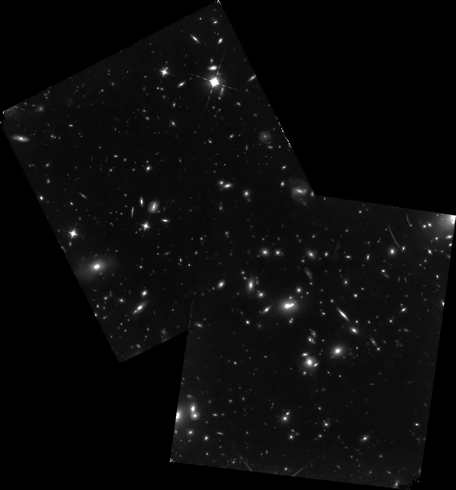
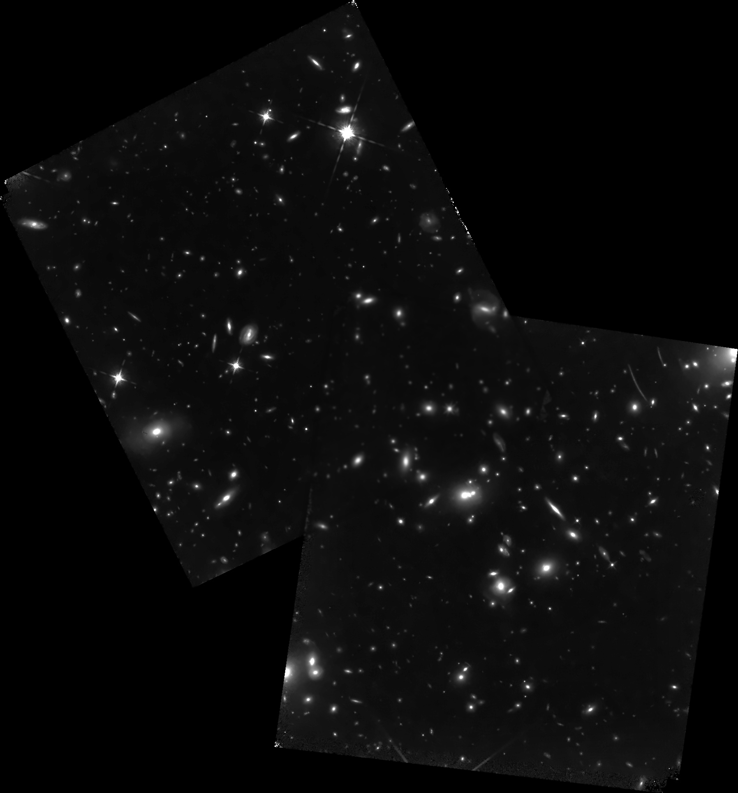
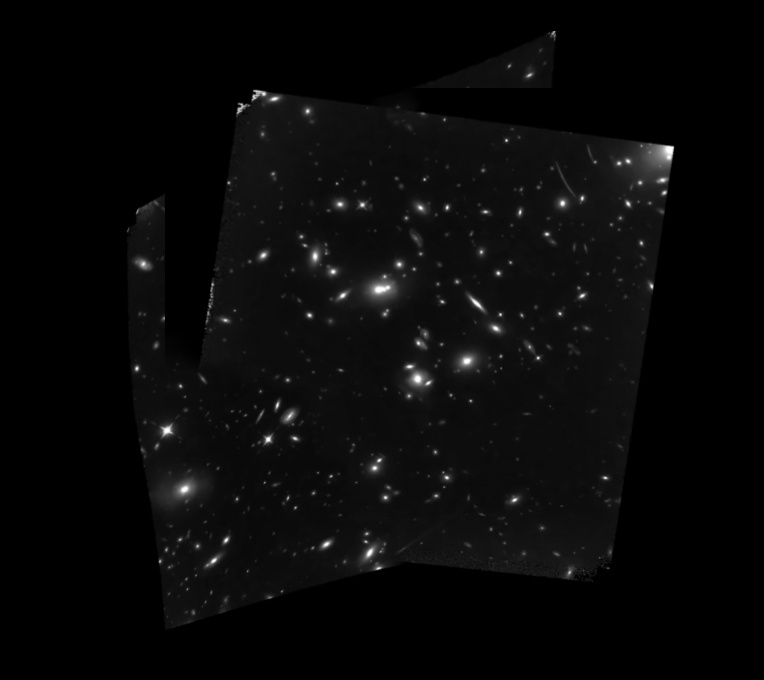
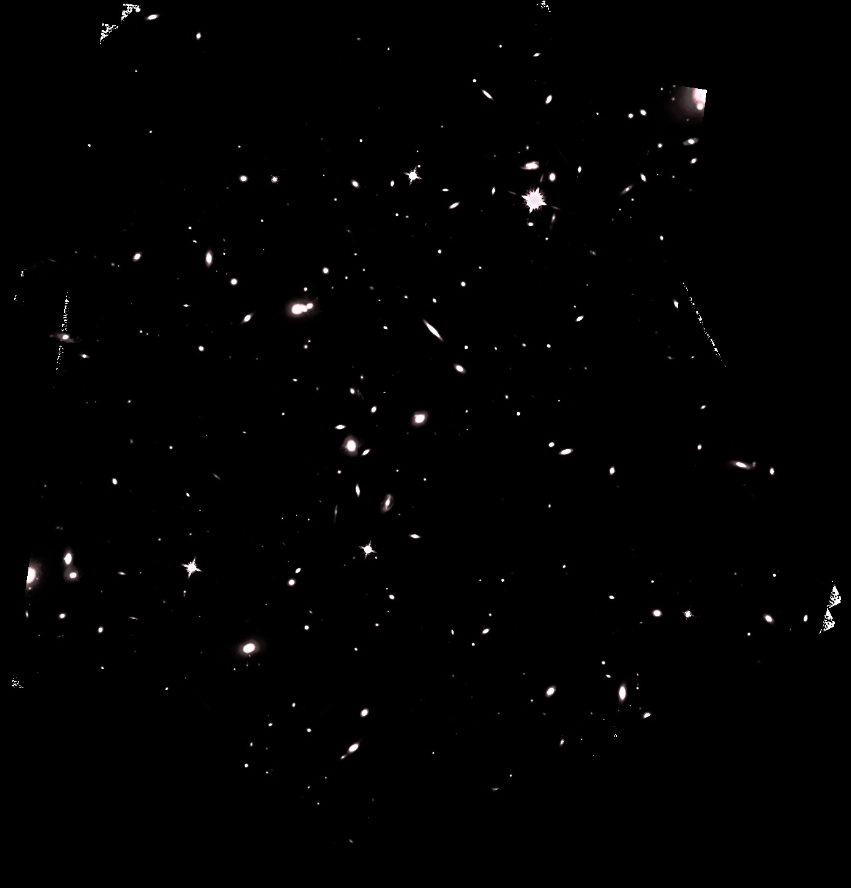
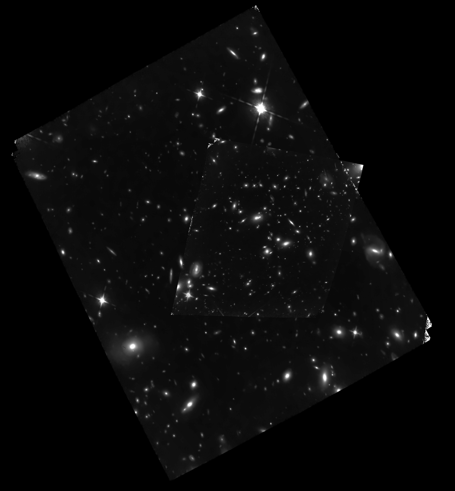
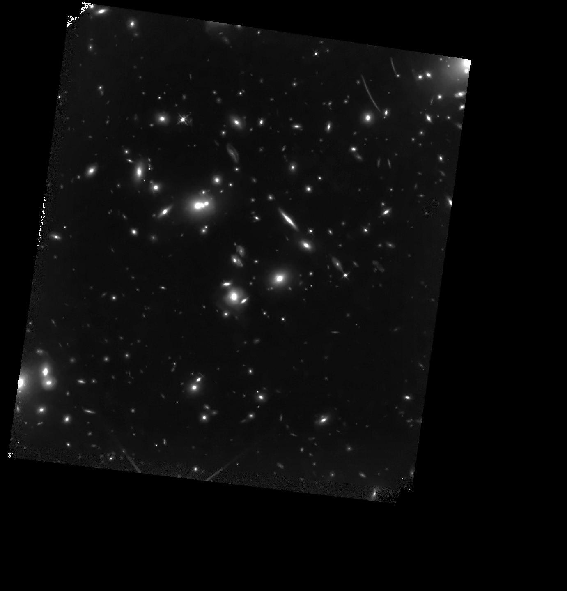
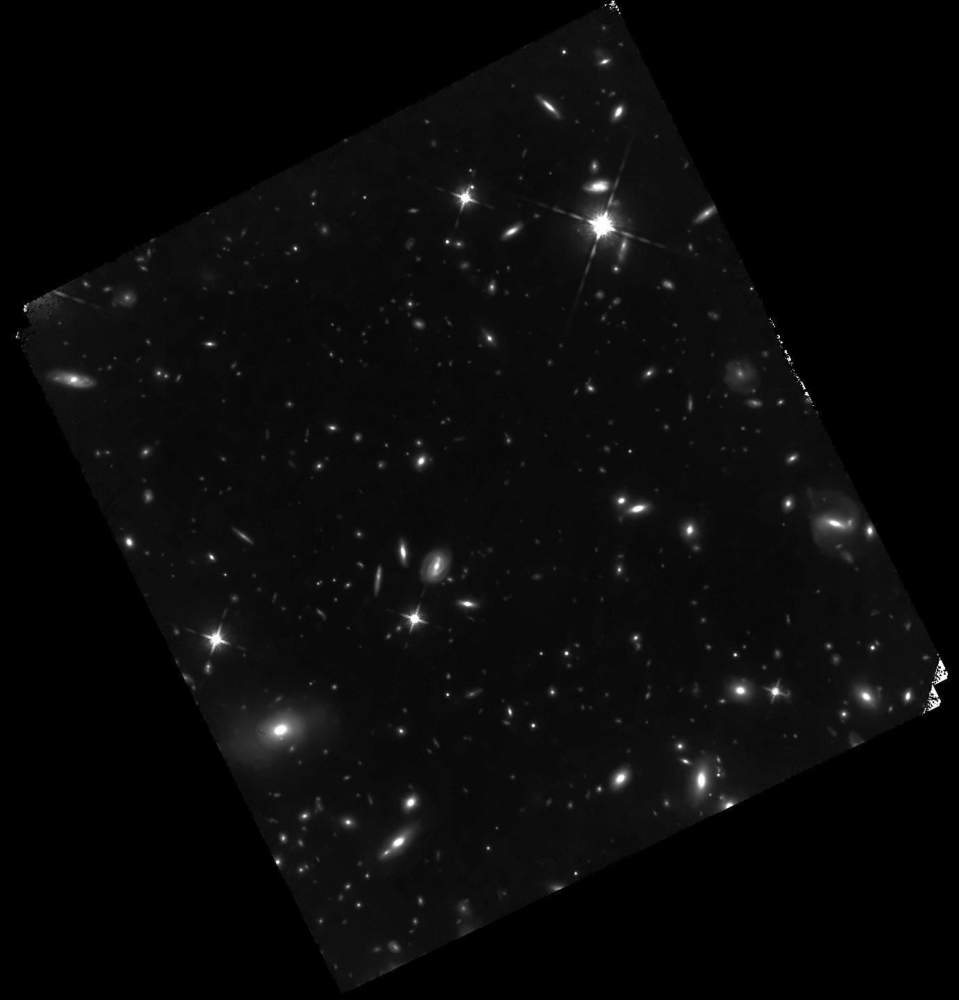

# Astronomical Image Stitching Dataset
## About the data
The dataset contains 15 pairs of overlapping images taken with the Hubble Space Telescope (HST) and obtained from the [Mikulski Archive for Space Telescopes (MAST)](https://archive.stsci.edu) in FITS format. The images come from the WFC3, ACS and WFPC2 instruments and show different types of objects: galaxy clusters, spiral and interacting galaxies, globular and open star clusters, emission nebulae and a supernova remnant.

Before stitching, the images were converted to 8-bit JPG images (percentile stretching, gamma correction, noise reduction and contrast enhancement). Each pair was stitched with eight methods: **SIFT, ORB, AKAZE, Astroalign, UDIS, DHS, ACDIS and RopStitch**. This gives 120 possible results; for 30 of them the method did not produce an output image, so **90 stitched images** are included. For five scenes a reference mosaic is also available.

## Data source
Hubble Space Telescope data obtained from the Mikulski Archive for Space Telescopes (MAST) at the Space Telescope Science Institute (STScI), operated by AURA for NASA/ESA. The original FITS files are available at MAST; this repository contains the preprocessed JPG images used in the experiments.

| SIFT | ORB | AKAZE | Astroalign | UDIS | DHS | ACDIS | RopStitch |
|---|---|---|---|---|---|---|---|
|  |  |  |  |  |  |  |  |  |

## Image pairs
### 1. Abell S1063
- **Telescope, instrument and filter:** HST/WFC3, F160W

| Input 1 | Input 2 |  
|---|---|
|  |  |

| SIFT | ORB | AKAZE | DHS | ACDIS | RopStitch |
|---|---|---|---|---|---|
|  |  |  |  |  |  |  |

### 1. Abell S1063
- **Telescope, instrument and filter:** HST/WFC3, F160W

| Input 1 | Input 2 |  
|---|---|
|  |  |

| SIFT | ORB | AKAZE | DHS | ACDIS | RopStitch |
|---|---|---|---|---|---|
|  |  |  |  |  |  |  |
